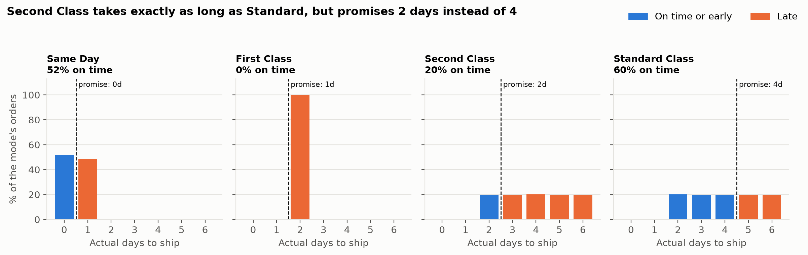
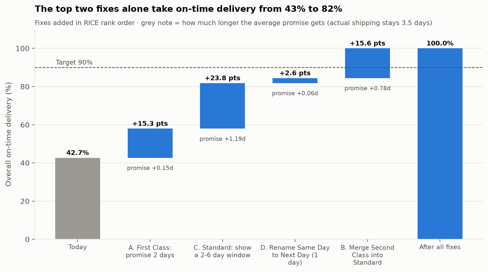

# Broken Delivery Promises: A Supply Chain Analytics → Product Case Study

**Question:** Why does DataCo deliver only 43% of orders on time, and what product change would fix it?

**Answer:** The warehouse isn't slow. **The delivery promises are wrong.** Each shipping mode promises
a fixed number of days that fulfillment never meets. Customers who pay for speed fare worst:
First Class is late **100%** of the time, and Second Class is **no faster than Standard**
despite promising half the time.



## Interactive dashboard

Open [`dashboard/index.html`](dashboard/index.html) in a browser (no install needed).
It has KPI tiles, the monthly trend, a scorecard by mode, and a **promise simulator**: click a
day on any mode's real delivery-time distribution to move its promise, and every
historical order is replayed against it. Filters for year, market and segment update everything.

## Key findings

| # | Finding | Evidence |
|---|---|---|
| 1 | On-time delivery (OTD) is **42.7%**, flat for 3 years, against a 90% target | [Q1 chart](outputs/figures/fig1_otd_by_month.png) |
| 2 | **First Class: 0% on time.** It always ships in 2 days but promises 1 | [Q2 table](outputs/tables/q2_mode_promise.csv) |
| 3 | **Second Class = Standard in speed** (2–6 days, uniform), but promises 2 days vs 4 | [Q3 chart](outputs/figures/fig2_actual_vs_promised.png) |
| 4 | Shipping mode moves the late rate by **60 pts**; region, product and customer by **≤7 pts** | [Q4 chart](outputs/figures/fig3_late_rate_by_dimension.png) |
| 5 | Hitting 90% OTD needs promises of 1 / 2 / 6 / 6 days (Same Day / First / Second / Standard) | [Q5 chart](outputs/figures/fig4_promise_calibration.png) |
| 6 | Late first orders do **not** reduce 90-day repurchase (29.0% vs 28.8%, p = 0.79) | [Q6 table](outputs/tables/q6_repeat_purchase.csv) |

**Implication:** fixing a warehouse, region or product line won't move OTD. The fix is a
*product* change to how delivery promises are set and shown. Full write-up:
[docs/phase3_findings.md](docs/phase3_findings.md).

## Recommended fixes



Ranked with RICE: **(A)** re-promise First Class to 2 days, **(C)** show Standard as a 2–6 day
window, **(D)** rename Same Day to Next Day, **(B)** merge Second Class into Standard.
A and C alone lift OTD from 43% to 82%. B ranks last on its own but triples in value after C,
and it's what crosses the 90% target. The cost: average promises lengthen from 2.9 to 5.1 days
while actual shipping stays at 3.5, so the claim is *trustworthy* promises, not *faster*
delivery. Details: [docs/phase4_prioritization.md](docs/phase4_prioritization.md) ·
every judgment call and who made it: [docs/decision_log.md](docs/decision_log.md).

## The proposed feature: Reliable Delivery Window

Replace each mode's fixed promise with a window computed weekly from real fulfillment
(*"Arrives Tue–Sat, usually Thu"*), committed at the day that covers ≥ 90% of orders.
With fixes A and D it lifts OTD to 84%, then past 90% with B. The risk is that later-looking
dates cost sales, so it ships behind an A/B **non-inferiority** test on checkout completion.
At DataCo's ~409 orders/week, a 2% margin would take 1–2 years to test, so the PRD sets
a 5% margin (10–17 weeks). Full PRD: [docs/phase5_prd.md](docs/phase5_prd.md).

## Approach

| Phase | What | Output | Status |
|---|---|---|---|
| 1. Explore | Profile 180k rows × 53 columns; test the meaning of the "late" flag | [phase1_findings.md](docs/phase1_findings.md) | ✅ |
| 2. Define | Clean the data; set business questions and KPIs (order-level OTD, excl. cancellations) | [business_questions.md](docs/business_questions.md) | ✅ |
| 3. Analyze | SQL (DuckDB) per question, Python charts, significance test | [phase3_findings.md](docs/phase3_findings.md) | ✅ |
| 4. Prioritize | Score 4 fixes with RICE; model their combined impact and the cost of longer promises | [phase4_prioritization.md](docs/phase4_prioritization.md) | ✅ |
| 5. Design | PRD for the Reliable Delivery Window: window rule from data, metrics and guardrails, A/B test sized to real volume | [phase5_prd.md](docs/phase5_prd.md) | ✅ |
| 6. Present | Interactive dashboard with a promise simulator; Tableau Public rebuild guide | [dashboard/index.html](dashboard/index.html) · [tableau_guide.md](docs/tableau_guide.md) | ✅ |

### Analytical decisions worth noting

- **Orders, not rows:** each row is an order *item*. All items in an order share one shipping
  outcome (verified on all 65,752 orders), so KPIs count each order once.
- **Our own `is_late`**, checked against the dataset's flag on all 172,765 shipped items.
  Canceled and fraud-held shipments are excluded, since they never shipped.
- **Repeat-purchase test design** avoids frequent-buyer bias (first orders only) and
  right-censoring (first orders placed ≥90 days before the data ends).
- **A caught error:** an apparent "50% volume drop" in late 2017 turned out to be orders
  shifting from about 3 items to 1. Order volume was steady.

## Limitations

- The dataset is **very likely synthetic**: shipping times are perfectly uniform, and geography has
  almost no effect. The method carries over to real data. The exact numbers would not.
- There's no cost, carrier, conversion or review data, so revenue impact can't be measured directly.
  Phase 4 states these as explicit assumptions.

## Repository layout

```
sql/                 one query per business question (+ shared views, Phase 4 scenarios)
sql/explore/         starter queries for your own exploration
scripts/             01_first_look → 02_clean → 03_analysis → 04_prioritize → 05_test_plan
                     → 06_build_dashboard → 07_export_tableau (+ query.py helper)
outputs/tables/      query results (CSV)
outputs/figures/     charts
docs/                findings, KPI definitions, PRD, decision log, Tableau guide
dashboard/           interactive dashboard (template.html + generated index.html)
tableau/             order-level CSV for the Tableau Public version
data/column_profile.csv   data dictionary generated in Phase 1
```

## Reproduce

1. Download `DataCoSupplyChainDataset.csv` from the
   [DataCo Smart Supply Chain dataset on Kaggle](https://www.kaggle.com/datasets/shashwatwork/dataco-smart-supply-chain-for-big-data-analysis)
   into `data/raw/`.
2. Set up and run:

```bash
python3 -m venv .venv && .venv/bin/pip install -r requirements.txt && ./run_all.sh
```

**Tools:** Python (pandas, matplotlib) · SQL (DuckDB) · Parquet · HTML/JavaScript (SVG charts) · Tableau Public
