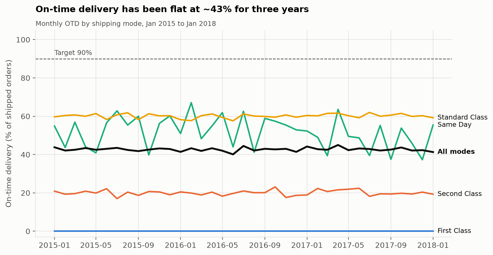
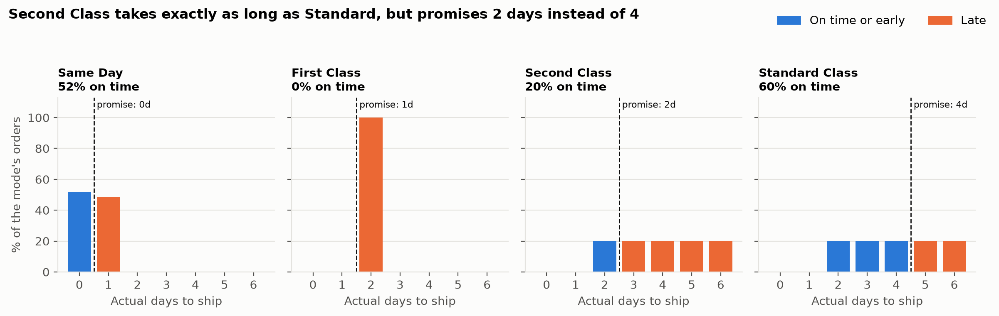
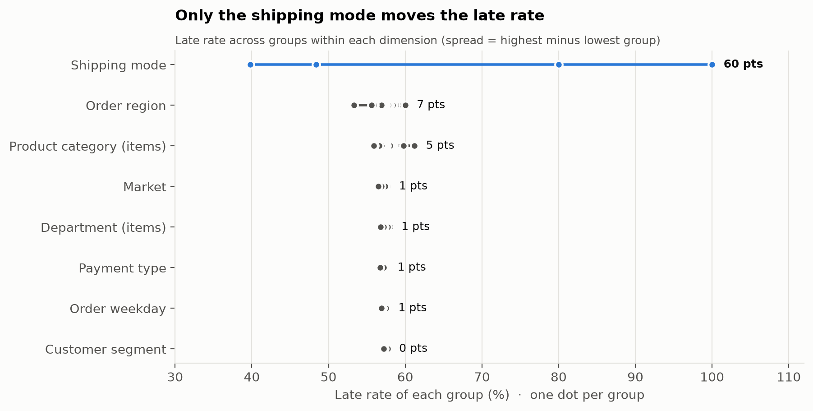
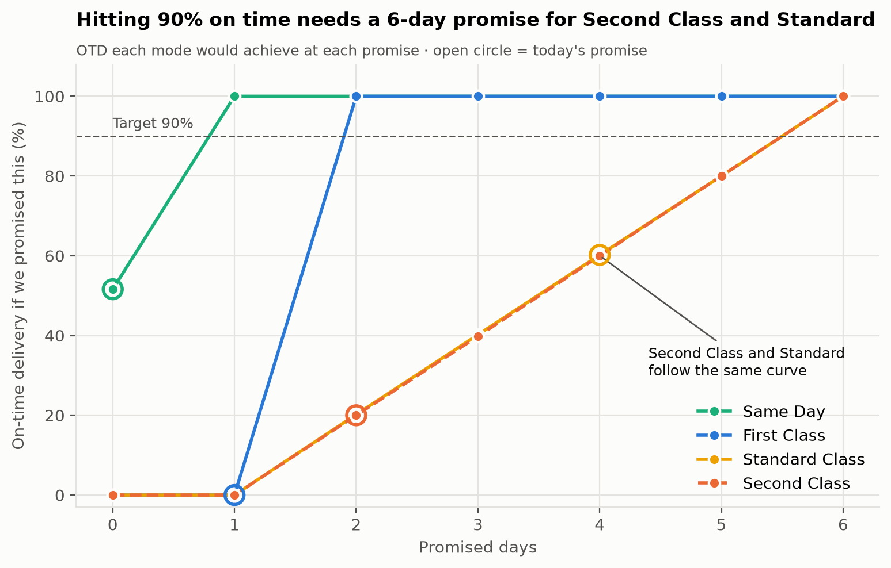

# Phase 3: Analysis Findings

**Code:** `sql/` (one query per question) + `scripts/03_analysis.py` (runs the SQL, charts, stats test)
**Result tables:** `outputs/tables/` · **Charts:** `outputs/figures/`
**Scope:** 62,897 shipped orders, Jan 2015 to Jan 2018. Headline KPI: order-level on-time delivery (OTD), excluding cancellations. Target: 90%.

## Summary

DataCo delivers only **42.7% of orders on time**, less than half the 90% target, and this
has not changed in three years. The cause is not a slow region, product or customer type.
It is the **delivery promise itself**: each shipping mode promises a fixed number of days
that fulfillment cannot meet. Premium customers are hit hardest. **First Class is late
100% of the time**, and **Second Class is no faster than Standard** even though it
promises half the time. Late first orders do **not** measurably reduce repeat purchases
in this data.

## Q1. How often do we break the promise, and is it changing?

- Monthly OTD stays between **40.1% and 45.0%**, averaging 42.7%. There is no trend.
- Each mode is just as stable. Same Day bounces around only because it has few orders (~90/month).
- **Takeaway:** this is a structural problem, not a temporary one.

## Q2 + Q3. Which modes break the promise, and are premium modes faster?

| Mode | Share of orders | Promise | Actual days | OTD | ≥2 days late |
|---|---|---|---|---|---|
| Same Day | 5.4% | 0 | 0 or 1 (≈50/50) | 51.6% | 0% |
| First Class | 15.3% | 1 | always 2 | **0.0%** | 0% |
| Second Class | 19.5% | 2 | 2–6, evenly | 20.0% | **60.2%** |
| Standard Class | 59.8% | 4 | 2–6, evenly | 60.2% | 20.0% |

- **First Class** is consistently fast (always 2 days) but promises 1, so it is *always* exactly 1 day late.
- **Second Class and Standard take exactly the same time** (2–6 days, each about 20%). Second
  Class promises 2 days, so 60% of its orders arrive 2+ days late.
- **Takeaway:** fulfillment speed is predictable per mode. The promises are what's wrong.

## Q4. Does lateness depend on where, what or who?

| Dimension | Spread in late rate (highest group − lowest) |
|---|---|
| **Shipping mode** | **60 pts** |
| Order region | 7 pts |
| Product category | 5 pts |
| Market, department, payment type, weekday, segment | ≤ 1 pt each |

- Shipping mode is the only factor that matters. Region and category spreads are small,
  and the extremes come from smaller groups. For example, Central Africa (533 orders) and
  Cameras (562 items) are well below the median group sizes of 2,605 orders and
  1,403 items, so their rates are noisier.
- **Takeaway:** fixing a single warehouse, region or product line would not move OTD. The fix
  has to be in how promises are set.

## Q5. What promise would hit the 90% target?

| Mode | Today's promise | Today's OTD | Promise needed for ≥90% |
|---|---|---|---|
| Same Day | 0 days | 51.6% | 1 day |
| First Class | 1 day | 0.0% | 2 days |
| Second Class | 2 days | 20.0% | **6 days** |
| Standard Class | 4 days | 60.2% | **6 days** |

- With these promises every mode would reach 100% OTD. Because shipping times are whole
  days with a hard maximum, the smallest promise above 90% here is also the worst case.
- **The catch:** an honest Second Class promise is identical to Standard. As things stand,
  Second Class is not a real speed tier.
- A 6-day Standard promise could reduce checkout conversion. We **cannot measure that in
  this data**, so the product proposal needs to treat it as a risk and test it.

## Q6. Does a late first order reduce repeat purchases?

Design: each customer's **first** shipped order. Only first orders at least 90 days before
the data ends were counted, so recent customers aren't mistaken for lost ones. The outcome
is any other order within 90 days.

| First order | Customers | Re-ordered within 90 days |
|---|---|---|
| Late | 8,187 | 29.0% |
| On time | 6,177 | 28.8% |

- The difference is +0.2 points (two-proportion z-test: z = 0.26, p = 0.79). **There's no evidence of an effect.**
- **Takeaway:** the business case for fixing promises **can't rest on retention** in this
  dataset. It rests on **trust and honesty**: today 57% of customers receive a broken
  promise, and the customers paying for speed fare worst. Real-world research generally
  links late delivery to churn and support costs, but we should say clearly that this
  dataset doesn't show it.

## Limitations

- The data is **very likely synthetic**: shipping times are perfectly uniform, and region and
  category have almost no effect. The *method* carries over to real data. The exact numbers would not.
- There's no shipping cost, carrier, review, return or conversion data, so we can't size revenue impact directly.
- `days_actual` is 1 day more than the gap between the two dates on 2.6% of rows. This is consistent and minor.

## Implications for Phase 4 (root causes and opportunities)

1. **Recalibrate promises per mode:** First Class at 2 days, Same Day at 1 day, then decide how to handle Second Class vs Standard.
2. **Second Class problem:** either make it genuinely faster (an operations fix) or merge it into Standard or reprice it (a product fix).
3. **Show customers a range** ("arrives in 2–6 days") or a promise-by-confidence estimate, instead of one fixed number.
