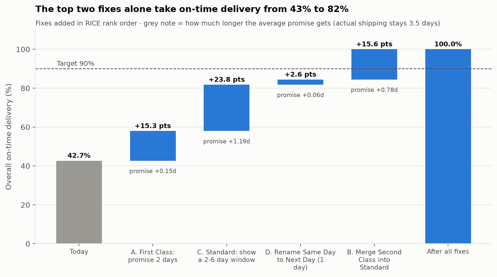

# Phase 4: Prioritizing the Fixes

**Code:** `sql/p4_fix_scenarios.sql` (what each fix does) + `scripts/04_prioritize.py` (RICE, cumulative impact, chart)
**Tables:** `outputs/tables/p4_*.csv` · **Decisions and who made them:** [decision_log.md](decision_log.md)

## The fixes

Phase 3 showed that lateness comes from promises that don't match fulfillment. Each fix
below changes a **promise**. None of them changes shipping speed.

| Fix | Change | Why |
|---|---|---|
| **A** | First Class: promise 1 → **2 days** | It always ships in exactly 2 days |
| **B** | **Merge Second Class into Standard** | It ships no faster than Standard (2–6 days) |
| **C** | Standard: show a **2–6 day window**, committed by day 6 | Matches the real spread; the early end keeps checkout appealing |
| **D** | Rename Same Day → **Next Day** (1-day promise) | Same-day delivery happens only 52% of the time; next-day happens 100% |

## How each fix was scored: RICE

**RICE = Reach × Impact × Confidence ÷ Effort**

- **Reach × Impact** comes from the data. Every historical order is replayed against the new
  promise, giving *extra on-time orders per month*.
- **Confidence** and **Effort** are judgment calls. The reasons are written out so anyone can challenge them.

| Rank | Fix | Reach (orders/mo) | Extra on-time orders/mo | Confidence | Effort (person-wks) | **RICE** |
|---|---|---|---|---|---|---|
| 1 | **A.** First Class → 2 days | 260 | 260 | High (1.0) | 1 | **260** |
| 2 | **C.** Standard 2–6 day window | 1,017 | 405 | Medium (0.8) | 6 | **54** |
| 3 | **D.** Same Day → Next Day | 92 | 45 | Medium (0.8) | 2 | **18** |
| 4 | **B.** Merge Second Class | 331 | 132 | Low (0.5) | 4 | **16.5** |

Reasons for the judgment calls:
- **A:** only one number in the promise rules changes, and the outcome is certain (First Class ships in exactly 2 days).
- **C:** needs new delivery-window logic and UI across checkout, emails and tracking. The on-time gain is certain, but the effect on conversion is unknown.
- **D:** small and cheap, but renaming a premium tier may reduce demand for it.
- **B:** touches checkout, pricing and finance. There's no shipping-fee data, so the revenue effect is a blind spot.

## Cumulative impact

| After | Overall OTD | Avg promise | Avg actual |
|---|---|---|---|
| Today | 42.7% | 2.94 days | 3.5 days |
| + A | 58.0% | 3.09 | 3.5 |
| + C | 81.8% | 4.28 | 3.5 |
| + D | 84.4% | 4.34 | 3.5 |
| + B | **100.0%** | 5.12 | 3.5 |

## What this tells us

1. **Ship A immediately.** It's a one-week change worth +15 points of OTD.
2. **C is the real product feature.** It's the biggest single gain (+24 pts) and the only one that
   needs actual design work. It becomes the **Phase 5 PRD**.
3. **B ranks last, but it's what crosses the 90% target.** Scored on its own, B lifts Second Class
   orders from 20% to 60% on time. After C, merged orders inherit the 6-day window and reach
   100%, so B's gain triples (+15.6 pts). **A ranking is a starting point, not a verdict.**
   Fixes interact, and the target can't be reached without B.
4. **D is a cheap tidy-up** that can ship alongside A.

## The honest cost: "Aren't you just moving the goalposts?"

Yes, partly, and the analysis has to say so:

- The average promise grows from **2.9 to 5.1 days**. Actual shipping stays **3.5 days**.
- After all fixes, a typical order arrives **about 1.6 days earlier than promised**. That's
  reliable, but it may look slow at checkout and cost sales.
- So the claim is **"promises customers can trust,"** not **"faster delivery."**

What this means for Phase 5:
- **Guardrail metrics:** checkout conversion and premium-shipping uptake must not drop.
- **Report actual speed separately,** so a gain in on-time rate is never mistaken for faster delivery.
- **Long term,** the way to shorten promises honestly is to make fulfillment faster and less
  variable. Standard's 2–6 day spread is the operations problem underneath.

## Recommended roadmap

| When | What |
|---|---|
| Now | **A + D**: re-promise First Class, rename Same Day → Next Day (~3 person-weeks total) |
| Next | **C**: the delivery-window feature, A/B tested against conversion (Phase 5 PRD) |
| After C's test reads out | **B**: merge Second Class, if C's test shows customers accept the window |
| Later (operations) | Narrow Standard's 2–6 day spread so promises can shrink honestly |
